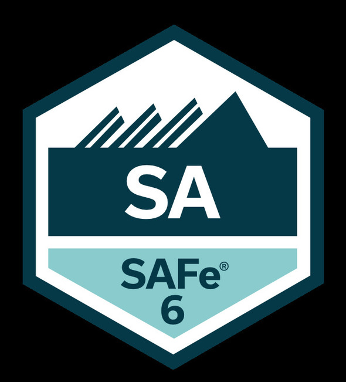
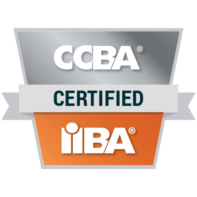
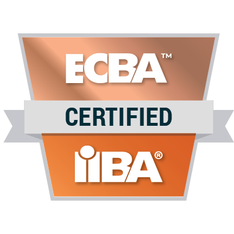
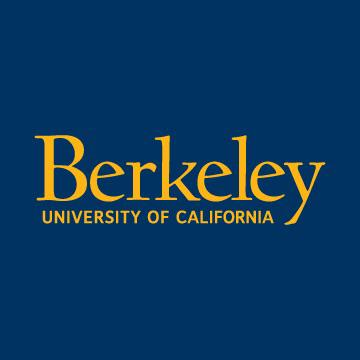

# Hi, I'm Nana 👋

## *Senior Business Analyst & Project Manager*

I specialize in bridging the gap between ambiguous business needs and technical execution. With over **9+ years in Senior Business Analysis** and **6+ years in Project Management** I lead large-scale cross-functional teams to deliver predictable, high-quality outcomes in high-stakes environments.

### What I Focus On
* 🤖 **AI-Assisted & Spec-Driven Development:** Writing machine-readable specs that AI coding agents can act on directly.
* 🚀 **End-to-End Product Delivery:** Managing the full SDLC/PMLC from discovery to deployment.
* ⚙️ **Agile Transformation:** Certified SAFe® 6 Agilist focused on optimizing velocity, throughput, and predictability.
* 🏦 **High-Regulated Domains:** Navigating complex requirements in Finance, Fintech (AML/KYC), and iGaming.
* 📊 **Technical Alignment:** Translating high-level goals into precise BPMN/UML models for engineering teams.

---

### 🌍 Industry Expertise
* 💳 **Fintech & Payments:** Expertise in card processing, digital wallets, ATM integrations, and AML/KYC compliance.
* 📈 **Finance:** Orchestrating strategic discovery and roadmaps for complex Investment Management initiatives.
* 🎰 **iGaming:** Leading large-scale delivery for core web platforms and internal control systems.
* 📱 **Media & Publishing:** Delivering high-load content management systems and native iOS/Android apps.
* 🛒 **eCommerce:** Managing complex digital ecosystems to drive operational excellence.

---

### 🛠️ Technical Skills, Methodologies and Languages
| Category | Skills & Tools |
| :--- | :--- |
| **MSpec-Driven Dev** | Cursor, Replit, Lovable, GitHub Spec-Kit, spec.md authoring, AI agent prompt specs, ACs as executable gates |
| **Methodologies & Frameworks** | SAFe (Scaled Agile Framework), Scrum, Kanban, Agile, SDLC, PMLC |
| **Metrics & KPIs** | Velocity & Throughput, Cycle Time/Lead Time, Predictability Reporting, SLA Management |
| **Management** | Stakeholder Management, Risk Mitigation, Resource Allocation, Strategic Alignment |
| **Analysis** | Requirements Engineering (BRD, FRD, SRS), Prioritization, User Stories & Use Cases, Acceptance Criteria |
| **Project Tools** | Jira/Confluence, Azure DevOps, Notion |
| **Diagrams and Design** | Microsoft Visio, LucidChart, Draw.io, Miro, Mural, Figma (for prototyping and wireframing) |
| **Modeling** | BPMN 2.0, UML (Sequence, Activity, Use Case Diagrams, Flow Charts), Value Stream Mapping |
| **Data** | MySQL, MongoDB |
| **Testing and Quality** | User Acceptance Testing (UAT), Test Plans, Traceability Matrix (RTM) |
| **Languages** | Georgian (Native), English (C1+), Russian (B2+), French (B1) |

---

### 🎓 Education and Certifications
| | | |
| :---: | :---: | :---: |
|  **SAFe® 6 Agilist** |  **PSM I** |  **TAL TECH MBA** |
|  **IIBA® CCBA** |  **IIBA® ECBA** |  **UC Berkeley AI Strategy** |
