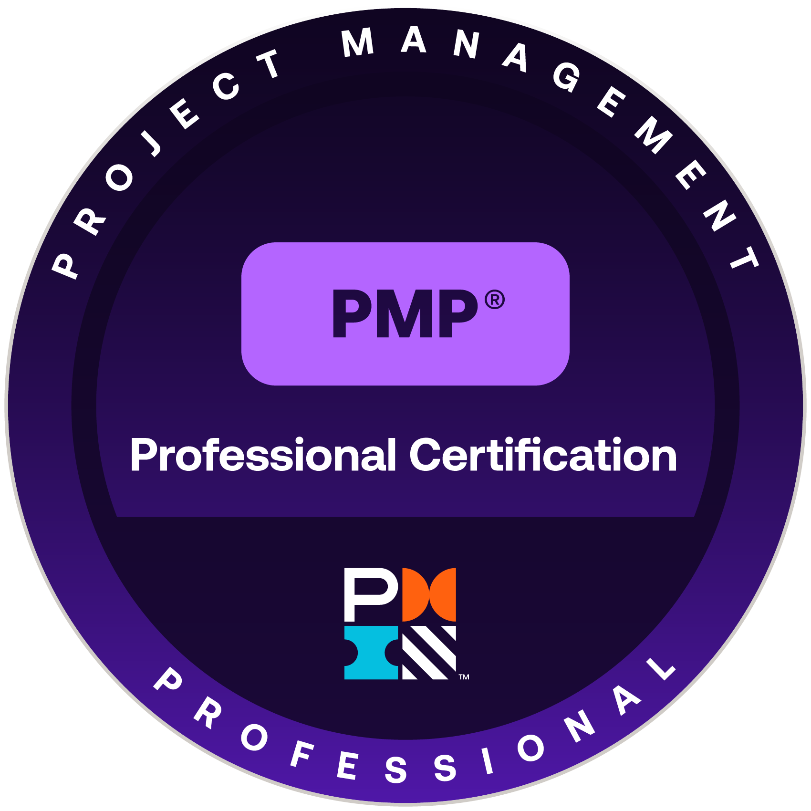

# Hi, I'm Nana 👋

## *Project & Delivery Manager (PMP®) · Senior Business Analyst (CCBA®)*

I own delivery end to end: scoping, planning, execution, risk control, UAT, production rollout and hypercare. With **6+ years of hands-on Project Management** and **9+ years of Senior Business Analysis** across Finance, Fintech & Payments, Media & Publishing and iGaming, I use a strong technical background to spot cross-functional dependencies early and resolve issues before they escalate, steering teams with delivery metrics in Scrum, Kanban and SAFe® environments.

📍 Tbilisi, Georgia · [LinkedIn](https://linkedin.com/in/nturmanidze) · [All credentials](https://www.credential.net/profile/nanaturmanidze351891)

---

### 🔭 What I'm Working On Now
I'm a Senior Business Analyst at **Exadel**, working with a Big Four client to move their investment management platform from legacy SQL to **Databricks**. The work covers calculations, data imports, outputs and reports. I work with two Scrum teams, architects and QA to make sure the new platform gives the same results as the old one. That way business users get faster, more reliable calculations without changing how they work.

---

### 🏆 Key Achievements
* 💳 Launched a **Fintech digital wallet** that scaled to **65,000+ active users** and **5,000+ daily transactions** within 12 months at **99.9% uptime**.
* 📱 Delivered **native iOS and Android apps** from wireframes to App Store and Google Play approval, meeting **100% of launch deadlines**.
* 🐞 Cut **post-release defects by 75%** by standardizing delivery and handoff frameworks across 4 Scrum teams (50+ people).
* 🔄 Contributing to a **zero-disruption SQL → Databricks migration** of investment calculations and reporting.

---

### 🎯 What I Focus On
* 🚀 **End-to-End Delivery:** Scope, milestones, release sequencing, cutover and hypercare across the full SDLC/PMLC.
* ⚠️ **Risk & Dependency Management:** RAID tracking, cross-team dependencies and resource/capacity planning.
* ⚙️ **Agile Delivery:** SAFe® 6 Agilist working in Scrum and Kanban teams, using delivery metrics to keep releases predictable.
* 🏦 **Highly Regulated Domains:** Investment Management, Fintech (AML/KYC, banking integrations) and iGaming.
* 🤖 **Agentic AI in Project Delivery:** Spec-driven workflows with Claude, Cursor and GitHub Spec-Kit, plus automation with n8n and UiPath.

---

### 🌍 Industry Expertise
* 📈 **Finance (Investment Management):** Migration of investment calculations, data imports and reporting from legacy SQL to Databricks.
* 💳 **Fintech & Payments:** Digital wallet, integrations with national banks (TBC, Bank of Georgia) and government providers, instant ATM withdrawals, utility payments, AI-driven KYC and real-time AML/Interpol blacklist sync.
* 📱 **Media & Publishing:** High-load CMS for real-time updates during peak sporting events, responsive web platform and native iOS/Android apps.
* 🎰 **iGaming:** Core web platform and 5+ bespoke internal control systems (CRM, CMS, Campaign Management).

---

### 🛠️ Skills, Tools and Languages
| Category | Skills & Tools |
| :--- | :--- |
| **Project & Delivery** | Scope, Timeline & Milestone Planning, Risk & Dependency Management (RAID), Resource & Capacity Planning, Status Reporting, Stakeholder Management, Release & Cutover Planning |
| **Delivery Metrics** | Velocity, Burndown, Cycle Time |
| **Methodologies** | Scrum, Kanban, SAFe®, Agile, PMBOK® practices, SDLC, PMLC |
| **Analysis & Quality** | Requirements Engineering (BRD, FRD, SRS), Backlog Prioritization, Acceptance Criteria, RTM, UAT, Test Planning, Hypercare |
| **App Release** | Google Play Console, Apple App Store Connect (app setup, store listings, review and publishing) |
| **Data & Platforms** | Databricks, SQL, MySQL, MongoDB, Firebase/Firestore, CI/CD pipelines |
| **Tools** | Jira, Confluence, Azure DevOps, Trello, Notion, Visio, LucidChart, Figma |
| **Modeling** | BPMN 2.0, UML |
| **AI & Automation** | Claude, ChatGPT, Cursor, n8n, UiPath, GitHub Spec-Kit, MCP integrations (Cursor–Figma, Claude connectors), Agentic AI in project delivery |
| **Languages** | Georgian (Native), English (C1+), Russian (B2), French (B1) |

---

### 🎓 Certifications

**Project Management, Agile & Business Analysis**

<table>
  <tr>
    <td align="center" width="160"> <b>PMP®</b> PMI · 2026</td>
    <td align="center" width="160"> <b>SAFe® 6 Agilist</b> Scaled Agile · 2026</td>
    <td align="center" width="160"> <b>PSM I</b> Scrum.org · 2019</td>
    <td align="center" width="160"> <b>CCBA®</b> IIBA · 2024</td>
    <td align="center" width="160"> <b>ECBA®</b> IIBA · 2023</td>
  </tr>
</table>

**AI**

<table>
  <tr>
    <td align="center" width="160"> <b>Foundations of Agentic AI</b> PMI · 2026</td>
    <td align="center" width="160"> <b>Agentic AI Build Lab</b> PMI · 2026</td>
    <td align="center" width="160"> <b>AI: Business Strategies</b> UC Berkeley Haas · 2024</td>
  </tr>
</table>

Also: **ChatGPT Deployment Practitioner** and **ChatGPT Solutions Practitioner**, OpenAI Partner Network (2026)

---

### 🏛️ Education

| Degree | School | Years |
| :--- | :--- | :---: |
| **MBA, International Business Administration** | TalTech, Tallinn University of Technology, Estonia | 2016 – 2019 |
| **BA, International Relations and Political Science** | Ilia State University, Tbilisi | 2006 – 2010 |
